<!--
  Hey, nice of you to peek at the source.
  Images: capsule-render, readme-typing-svg, skillicons, shields.io,
  streak-stats, Platane/snk and my own stats script (scripts/gen_stats.py).
-->

  

  

### 🛠️ Tech I build with

### 🚀 Projects

| | Project | What it does |
|:-:|---|---|
| 🤖 | **[jarvis-hud](https://github.com/Zedas030/jarvis-hud)** | German-speaking voice assistant with a memory HUD, intent router and its own speech engine. Runs the apartment through Home Assistant. |
| 🛰️ | **[orbit-netzwerkdoku](https://github.com/Zedas030/orbit-netzwerkdoku)** | Home network monitoring, network docs and security center on a Raspberry Pi. Three websites, no framework. |
| 🗄️ | **[orbit-rack-demo](https://github.com/Zedas030/orbit-rack-demo)** | Interactive demo of a fictional homelab rack: network map, VLANs, power flow, events. |
| ☀️ | **[solaris](https://github.com/Zedas030/solaris)** | Local energy dashboard for solar with battery storage. FastAPI + SQLite, data from MQTT, Prometheus or Home Assistant. |
| 🔋 | **[noah-nulleinspeisung](https://github.com/Zedas030/noah-nulleinspeisung)** | Zero-export control for the Growatt NOAH 2000: drives the battery by household load, with watchdogs. |
| 🏙️ | **[cs2-agent-helpers](https://github.com/Zedas030/cs2-agent-helpers)** | An AI agent builds cities in Cities: Skylines II: autopilot, grid building, service placement. |
| 🏠 | **[homeassistant-automationen](https://github.com/Zedas030/homeassistant-automationen)** | Reusable automations: tablet battery care, watchdogs, alerts to the phone. |
| 📺 | **[fire-tv-debloat](https://github.com/Zedas030/fire-tv-debloat)** | Debloat a Fire TV over ADB: ads, telemetry and bloatware gone, all reversible. |

### 📊 Stats

  
  

  

### 🐍 Contribution graph

<picture>
  <source media="(prefers-color-scheme: dark)" srcset="https://raw.githubusercontent.com/Zedas030/Zedas030/output/github-contribution-grid-snake-dark.svg">
  <source media="(prefers-color-scheme: light)" srcset="https://raw.githubusercontent.com/Zedas030/Zedas030/output/github-contribution-grid-snake.svg">
  
</picture>

> [!TIP]
> Everything here runs privately at home, and the repos are anonymized. If something helps you, take it, and a ⭐ is always appreciated.

