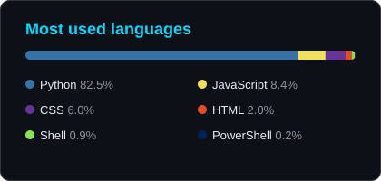

<!--
  Hey, nice of you to peek at the source.
  Images: capsule-render, readme-typing-svg, skillicons, shields.io,
  streak-stats, Platane/snk and my own stats script (scripts/gen_stats.py).
-->

  

<h1 align="center">Let's connect and have a chat! 💬</h1>

  
  
  
  

---

<h2>👨🏻‍💻 &nbsp;A little bit about me</h2>

  

### 🛠️ Tech I build with

### 🚀 Projects

| | Project | What it does |
|:-:|---|---|
| 🤖 | **[jarvis-hud](https://github.com/Zedas030/jarvis-hud)** | Self-hosted voice assistant with memory, smart home control and a HUD, powered by the Claude Code CLI. |
| 🧪 | **[restore-probe](https://github.com/Zedas030/restore-probe)** | Proves every night that backups can really be restored: restores them into an isolated sandbox and compares the data with production. |
| 🧭 | **[homelab-drift](https://github.com/Zedas030/homelab-drift)** | Documentation of the homelab generated from the real system state, with an alert when something undocumented changes. |
| 💥 | **[blast-radius](https://github.com/Zedas030/blast-radius)** | Automatic dependency map of the homelab and smart home that answers "what fails if X fails?" – with a SPOF list and the likely cause when many Home Assistant entities drop out at once. |
| 📶 | **[zigbee-placement-advisor](https://github.com/Zedas030/zigbee-placement-advisor)** | Watches Zigbee (ZHA) link quality over weeks and tells you which room a new router would help most – with confidence, an honest "not enough data", and an automatic before/after check. |
| 🛡️ | **[update-airlock](https://github.com/Zedas030/update-airlock)** | Tests container updates (Home Assistant first) in a sealed sandbox against a copy of the real config, holds them back when a breaking change hits an integration in use, updates in a maintenance window and rolls back automatically. |
| 🌐 | **[exposure-guard](https://github.com/Zedas030/exposure-guard)** | Watches what the home network exposes to the internet: an external VPS probe scans IPv4 and every IPv6 address in the LAN, port forwards are told apart as manual or UPnP and traced to the device, new devices, TLS and Tailscale are checked – read-only, with immediate alerts and a missing scan never looking like "all clear". |
| ✅ | **[ha-automation-auditor](https://github.com/Zedas030/ha-automation-auditor)** | Read-only auditor for Home Assistant automations: finds broken references, dead automations, impossible conditions, conflicts and loops, explains the fix, and previews what will run in the next hours. |
| 🔌 | **[power-hog-detective](https://github.com/Zedas030/power-hog-detective)** | Learns the normal power pattern of every smart plug in Home Assistant and explains unusual behaviour in plain language – longer fridge cycles, rising base load, devices left running – with a monthly report of costs and savings. |
| 🔋 | **[home-battery-doctor](https://github.com/Zedas030/home-battery-doctor)** | Tracks the health of home batteries from the data Home Assistant already records: real usable capacity with a confidence range, ageing trend and forecast, master/slave analysis of stacked units, warranty watchdog and a PDF warranty dossier – read-only, and honest "no reliable statement" when the data is too thin. |
| 🗄️ | **[orbit-rack-demo](https://github.com/Zedas030/orbit-rack-demo)** | Interactive demo of a fictional homelab rack: network map, VLANs, power flow, events. |
| 🔋 | **[noah-zero-export](https://github.com/Zedas030/noah-zero-export)** | Zero-export control for the Growatt NOAH 2000: drives the battery by household load, with watchdogs. |
| 🏙️ | **[cs2-agent-helpers](https://github.com/Zedas030/cs2-agent-helpers)** | An AI agent builds cities in Cities: Skylines II: autopilot, grid building, service placement. |
| 🏠 | **[homeassistant-automation](https://github.com/Zedas030/homeassistant-automation)** | Reusable automations: tablet battery care, watchdogs, alerts to the phone. |
| 📺 | **[fire-tv-debloat](https://github.com/Zedas030/fire-tv-debloat)** | Debloat a Fire TV over ADB: ads, telemetry and bloatware gone, all reversible. |

🇩🇪 German editions: [jarvis-hud-de](https://github.com/Zedas030/jarvis-hud-de) · [noah-nulleinspeisung-de](https://github.com/Zedas030/noah-nulleinspeisung-de) · [cs2-agent-helpers-de](https://github.com/Zedas030/cs2-agent-helpers-de) · [fire-tv-debloat-de](https://github.com/Zedas030/fire-tv-debloat-de) · [solaris-de](https://github.com/Zedas030/solaris-de) (local solar + battery dashboard, German only).

### 📈 My GitHub History

  
  

  

<picture>
  <source media="(prefers-color-scheme: dark)" srcset="https://raw.githubusercontent.com/Zedas030/Zedas030/output/github-contribution-grid-snake-dark.svg">
  <source media="(prefers-color-scheme: light)" srcset="https://raw.githubusercontent.com/Zedas030/Zedas030/output/github-contribution-grid-snake.svg">
  
</picture>

> [!TIP]
> Everything here runs privately at home, and the repos are anonymized. If something helps you, take it, and a ⭐ is always appreciated.

